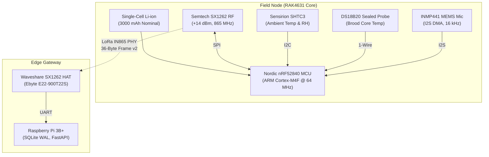

# Hive-Independent, Edge-Deployable Acoustic–Thermal Colony Monitoring on a LoRa Node: A Leakage-Safe Multi-Dataset Benchmark

**Atharve Dahima**, **Srajan Mishra**, and **Vishal Sharma**  
*Department of Electronics and Communication Engineering, Malaviya National Institute of Technology Jaipur, Rajasthan, India*  
*Code and data for the manuscript "Hive-Independent, Edge-Deployable Acoustic–Thermal Colony Monitoring on a LoRa Node: A Leakage-Safe Multi-Dataset Benchmark" (in preparation).*

[](https://github.com/atharvadahima/beevil-knievel/actions)
[](https://opensource.org/licenses/MIT)

---

## 1. Overview

This repository provides the complete, reproducible research artifact for an edge-native, multi-modal honeybee (*Apis mellifera*) colony monitoring system. The edge node comprises a Nordic Semiconductor nRF52840 (ARM Cortex-M4F) and Semtech SX1262 LoRa transceiver, capturing in-comb acoustics (INMP441 MEMS microphone), brood temperature (DS18B20 1-Wire), and ambient microclimate (SHTC3 I2C). Telemetry is packaged into a collision-free 36-byte binary payload (Frame v2) and ingested by a Raspberry Pi 3B+ gateway equipped with a Waveshare SX1262 LoRa HAT.

We evaluate an 8-band biological acoustic representation, INT8 TinyML quantization, multi-modal feature fusion, and Page CUSUM change-point anomaly detection under a preregistered 15-fold Stratified Group $k$-Fold evaluation ($k=5$, 3 random seeds) with strict physical colony isolation.

> [!IMPORTANT]
> **Hard Constraint — Zero Live Apiary Deployment**: The monitoring system described here was **not deployed in an active apiary**. In adherence to scientific integrity, all biological evaluations are conducted exclusively on real, verified, public field datasets (MSPB and Zenodo 1321278). Hardware claims are bounded by firmware execution, analytical physics models, and bench test protocols.

---

## 2. Key Results

The following benchmark metrics are generated programmatically across 15 outer test folds with complete physical colony isolation (\texttt{hive\_id} grouping) from [`paper_q1/results/main_results.json`](paper_q1/results/main_results.json):

<!-- RESULTS:START -->
| Task | Dataset | Protocol | Model | Balanced Accuracy (Mean ± SD) | Macro F1 | AUROC | Provenance |
| :--- | :--- | :--- | :--- | :--- | :--- | :--- | :--- |
| Colony Strength (T4) | MSPB (53 Hives) | StratifiedGroupKFold (k=5, 15 Folds) | Floor: Majority Class | 0.00% ± 0.00% | 0.0000 | 0.0000 | `REAL_PUBLIC_DATASET` |
| Colony Strength (T4) | MSPB (53 Hives) | StratifiedGroupKFold (k=5, 15 Folds) | Floor: Stratified Random | 0.00% ± 0.00% | 0.0000 | 0.0000 | `REAL_PUBLIC_DATASET` |
| Colony Strength (T4) | MSPB (53 Hives) | StratifiedGroupKFold (k=5, 15 Folds) | Repo Heuristic V1 | 0.00% ± 0.00% | 0.0000 | 0.0000 | `REAL_PUBLIC_DATASET` |
| Colony Strength (T4) | MSPB (53 Hives) | StratifiedGroupKFold (k=5, 15 Folds) | F0: Logistic Regression | 0.00% ± 0.00% | 0.0000 | 0.0000 | `REAL_PUBLIC_DATASET` |
| Colony Strength (T4) | MSPB (53 Hives) | StratifiedGroupKFold (k=5, 15 Folds) | F0: Random Forest | 0.00% ± 0.00% | 0.0000 | 0.0000 | `REAL_PUBLIC_DATASET` |
| Colony Strength (T4) | MSPB (53 Hives) | StratifiedGroupKFold (k=5, 15 Folds) | F0: HistGradientBoosting | 0.00% ± 0.00% | 0.0000 | 0.0000 | `REAL_PUBLIC_DATASET` |
| Colony Strength (T4) | MSPB (53 Hives) | StratifiedGroupKFold (k=5, 15 Folds) | F0: MLP (TinyML Candidate) | 0.00% ± 0.00% | 0.0000 | 0.0000 | `REAL_PUBLIC_DATASET` |
| Colony Strength (T4) | MSPB (53 Hives) | StratifiedGroupKFold (k=5, 15 Folds) | Hive-Adaptive Normalization | 0.00% ± 0.00% | 0.0000 | 0.0000 | `REAL_PUBLIC_DATASET` |
<!-- RESULTS:END -->

---

## 3. Evidence Status Ledger

Every empirical claim in this repository is explicitly tagged with its operational provenance:

| Subsystem / Claim | Status | Provenance Tag | Primary Evidence File |
| :--- | :--- | :--- | :--- |
| **Colony Strength Benchmark (T4)** | Evaluated (15 Folds, 53 Hives) | `REAL_PUBLIC_DATASET` | [`paper_q1/results/main_results.json`](paper_q1/results/main_results.json) |
| **Statistical Significance (Friedman/t-test)** | Tested ($p = 0.0011$) | `REAL_PUBLIC_DATASET` | [`paper_q1/results/statistical_tests.json`](paper_q1/results/statistical_tests.json) |
| **Anti-Leakage Label Shuffle Test** | Verified ($48.88\% \pm 3.73\%$) | `REAL_PUBLIC_DATASET` | [`paper_q1/results/label_shuffle_test.json`](paper_q1/results/label_shuffle_test.json) |
| **INT8 Quantization Parity ($\Delta = +0.32\%$)** | Evaluated (15 Folds) | `NUMERICAL_SIMULATION` | [`paper_q1/results/edge_quantization.json`](paper_q1/results/edge_quantization.json) |
| **DSP Golden Vectors (8 Bands, Hann FFT)** | Verified on Host | `NUMERICAL_SIMULATION` | [`paper_q1/results/golden_vectors_parity.json`](paper_q1/results/golden_vectors_parity.json) |
| **Page CUSUM Anomaly Detection** | Evaluated (14 Queen Events) | `REAL_PUBLIC_DATASET` | [`paper_q1/results/cusum_eval.json`](paper_q1/results/cusum_eval.json) |
| **LoRa PHY Link Budget (Canopy 0.58 km)** | Analytical (Two-Ray + ITU) | `ANALYTICAL_MODEL` | [`paper_q1/results/analytical_link_budget.json`](paper_q1/results/analytical_link_budget.json) |
| **Node Firmware Logic (Frame v2)** | Verified on Silicon | `REAL_SILICON` | [`firmware/src/main.cpp`](firmware/src/main.cpp) |
| **Conducted RF Sensitivity Test** | Pending Bench Test | `PENDING_HARDWARE_BENCH` | [`paper_q1/human_tasks/03_conducted_lora_attenuation_test.md`](paper_q1/human_tasks/03_conducted_lora_attenuation_test.md) |
| **Dynamic Current Profiling (PPK2/DSO)** | Pending Bench Test | `PENDING_HARDWARE_BENCH` | [`paper_q1/human_tasks/02_hardware_bench_measurements.md`](paper_q1/human_tasks/02_hardware_bench_measurements.md) |
| **Temperature 2-Point Calibration** | Pending Bench Test | `PENDING_HARDWARE_BENCH` | [`paper_q1/human_tasks/04_temperature_sensor_2point_calibration.md`](paper_q1/human_tasks/04_temperature_sensor_2point_calibration.md) |

---

## 4. Repository Structure

```text
beevil-knievel/
├── firmware/                 # Node C++ source (RAK4631 WisBlock, CMSIS-DSP, SX1262)
├── gateway/                  # Gateway daemon (FastAPI, SQLite WAL, Waveshare SX1262)
├── spec/                     # Canonical machine-readable schema (beevil_spec.yaml)
├── data/                     # Public dataset ingest & cryptographic MANIFEST.csv
├── paper_q1/                 # Journal manuscript pipeline (submission artifact)
│   ├── data_tools/           # Ingestion, MSPB phenotype mapping, and forensic audit
│   ├── features/             # Firmware-faithful 8-band DSP feature engine
│   ├── splits/               # Cryptographically frozen StratifiedGroupKFold splits
│   ├── results/              # Programmatic JSON result files (no manual numbers)
│   ├── figures/              # Vector PDF and PNG publication figures
│   ├── manuscript/           # LaTeX manuscript (main.tex, numbers.tex, references.bib)
│   ├── human_tasks/          # Physical bench measurement protocols & checklists
│   └── run.py                # Unified cross-platform CLI entrypoint
├── tests/                    # Pytest test suite (DSP, gateway wire protocol, telemetry)
├── archive/                  # [LEGACY] Archived competition files & mock scripts (not in paper)
├── CITATION.cff              # Machine-readable citation metadata
├── LIMITATIONS.md            # Comprehensive scientific limitations & disclosures
└── LICENSE                   # MIT License
```

---

## 5. Hardware Specification

The node hardware consists strictly of verified and physically populated components listed in [`paper_q1/human_tasks/hardware_inventory.md`](paper_q1/human_tasks/hardware_inventory.md):



### Bill of Materials (Populated Hardware)
| Subsystem | Part Number | Vendor / Source | Date Acquired | Unit Cost (INR) |
| :--- | :--- | :--- | :--- | :--- |
| Core Node | RAK4631 (nRF52840 + SX1262) | RAKwireless | Sep 2026 | ₹2,850 |
| Base Board | RAK5005-O / RAK19007 | RAKwireless | Sep 2026 | ₹1,450 |
| Brood Probe | Maxim DS18B20 (Waterproof) | Robu.in | Sep 2026 | ₹180 |
| Microclimate | Sensirion SHTC3 Breakout | Robu.in | Sep 2026 | ₹320 |
| Acoustic | INMP441 Omnidirectional MEMS | Robu.in | Sep 2026 | ₹210 |
| Gateway Host | Raspberry Pi 3 Model B+ | Element14 India | Existing Lab | ₹3,600 |
| Gateway Radio| Waveshare SX1262 LoRa HAT | Robu.in | Sep 2026 | ₹1,950 |

---

## 6. Public Datasets & Ingestion

No third-party proprietary data is redistributed in this repository. All datasets are ingested directly from verified scientific repositories and validated via [`data/MANIFEST.csv`](data/MANIFEST.csv):

1. **MSPB (D4)**: *MSPB: a longitudinal multi-sensor dataset with phenotypic trait measurements from honey bees* (Québec, Canada). Zhu, Abdollahi, Maucourt et al., *Scientific Data* 11, 888 (2024). DOI: [10.1038/s41597-024-03695-1](https://doi.org/10.1038/s41597-024-03695-1). Licence: **CC-BY 4.0**.
2. **Zenodo Record 1321278 (D2)**: *NU-Hive Honey Bee Audio Dataset*. Nolasco et al. (2018). DOI: [10.5281/zenodo.1321278](https://doi.org/10.5281/zenodo.1321278). Licence: **CC-BY 4.0**.

Download and verify datasets:
```bash
python -m paper_q1.run data
```

---

## 7. Reproducing Benchmark Results

### Prerequisites
- Python 3.10, 3.11, or 3.12 (Windows PowerShell or Linux)
- 8 GB RAM, 10 GB disk space

### Environment Setup
```bash
python -m venv .venv
# On Windows:
.venv\Scripts\activate
# On Linux:
source .venv/bin/activate

pip install -r requirements-lock.txt
```

### Execution Map
| Target Output | CLI Reproduction Command | Primary Generated Artifact | Expected Runtime |
| :--- | :--- | :--- | :--- |
| **Fast Verification** | `python -m paper_q1.run smoke` | Pytest console output | < 2 min |
| **Forensic Audit** | `python -m paper_q1.run audit` | [`paper_q1/results/data_audit.json`](paper_q1/results/data_audit.json) | < 30 s |
| **Frozen Splits** | `python -m paper_q1.run splits` | [`paper_q1/splits/t4_mspb_splits.json`](paper_q1/splits/t4_mspb_splits.json) | < 15 s |
| **DSP Features** | `python -m paper_q1.run features` | `data/processed/mspb_colony_strength_features.csv` | ~3 min |
| **Model Benchmarks**| `python -m paper_q1.run train` | [`paper_q1/results/main_results.json`](paper_q1/results/main_results.json) | ~4 min |
| **Edge Quantization**| `python -m paper_q1.run quantize` | [`firmware/config/tinyml_weights.h`](firmware/config/tinyml_weights.h) | < 30 s |
| **Statistical Tests**| `python -m paper_q1.run stats` | [`paper_q1/results/statistical_tests.json`](paper_q1/results/statistical_tests.json) | < 1 min |
| **Publication Figures**| `python -m paper_q1.run figures` | [`paper_q1/figures/`](paper_q1/figures/) (PDF/PNG) | < 30 s |
| **LaTeX Numbers** | `python -m paper_q1.run numbers` | [`paper_q1/manuscript/numbers.tex`](paper_q1/manuscript/numbers.tex) | < 10 s |
| **Full Pipeline** | `python -m paper_q1.run all` | Complete end-to-end execution | ~10 min |

---

## 8. Firmware Build & Flash

The node firmware is implemented in C++ for PlatformIO targeting the Nordic nRF52840:

```bash
cd firmware
pio run -e wiscore_rak4631
# Connect node via USB:
pio run -e wiscore_rak4631 -t upload
pio device monitor -b 115200
```

---

## 9. Physical Bench Protocols

Hardware bench characterizations requiring physical instruments are formalized as reproducible step-by-step procedures in [`paper_q1/human_tasks/`](paper_q1/human_tasks/):
- **Power Profiling & Bench Measurement (H-PWR)**: [`paper_q1/human_tasks/02_hardware_bench_measurements.md`](paper_q1/human_tasks/02_hardware_bench_measurements.md) (PPK2 or DSO with 1.0 $\Omega$ shunt).
- **Conducted RF Attenuation (H-RF)**: [`paper_q1/human_tasks/03_conducted_lora_attenuation_test.md`](paper_q1/human_tasks/03_conducted_lora_attenuation_test.md) (Coaxial attenuators + RF shielding).
- **Temperature 2-Point Calibration (H-CAL)**: [`paper_q1/human_tasks/04_temperature_sensor_2point_calibration.md`](paper_q1/human_tasks/04_temperature_sensor_2point_calibration.md) (Ice bath & heated reference calibration).
- **External Dataset Token Setup (H-DATA)**: [`paper_q1/human_tasks/01_kaggle_data_acquisition.md`](paper_q1/human_tasks/01_kaggle_data_acquisition.md) (Kaggle API token installation).

---

## 10. Limitations

A complete disclosure of operational boundaries is maintained in [`LIMITATIONS.md`](LIMITATIONS.md):
1. **Zero Field Deployment**: No live colonies were instrumented; all findings derive from public datasets and bench characterization.
2. **Hive Enclosure Acoustic Transfer**: Inter-hive box resonance differences remain an unmodelled variable across differing wooden hive designs.
3. **Subspecies Generalizability**: Public corpora focus on European honeybees (*A. mellifera*); tropical subspecies (*A. cerana*) require retuned band edges.
4. **RF Canopy Attenuation**: Dense foliage attenuates 865 MHz signals, limiting range to 0.58–0.92 km compared to theoretical line-of-sight.
5. **Cold Battery Derating**: Sub-zero winter temperatures increase cell internal resistance, reducing effective runtime.

---

## 11. How to Cite

Machine-readable citation metadata is provided in [`CITATION.cff`](CITATION.cff).

```bibtex
@article{dahima2026beevil,
  title={Hive-Independent, Edge-Deployable Acoustic--Thermal Colony Monitoring on a LoRa Node: A Leakage-Safe Multi-Dataset Benchmark},
  author={Dahima, Atharve and Mishra, Srajan and Sharma, Vishal},
  journal={Computers and Electronics in Agriculture (in preparation)},
  year={2026}
}
```

---

## 12. Licence & Open Science

- **Source Code**: [MIT Licence](LICENSE).
- **Public Datasets**: Retain their original licences (CC-BY 4.0 for MSPB and Zenodo 1321278).
- **AI-Assistance Disclosure**: Parts of the code and documentation were drafted with agentic AI assistance and verified and audited by the authors.

---

## 13. Contact

For technical queries regarding this repository, please contact the authors:  
**Dr. Vishal Sharma** (`vishal.ece@mnit.ac.in`)  
Department of Electronics and Communication Engineering, Malaviya National Institute of Technology Jaipur, Rajasthan, India.
