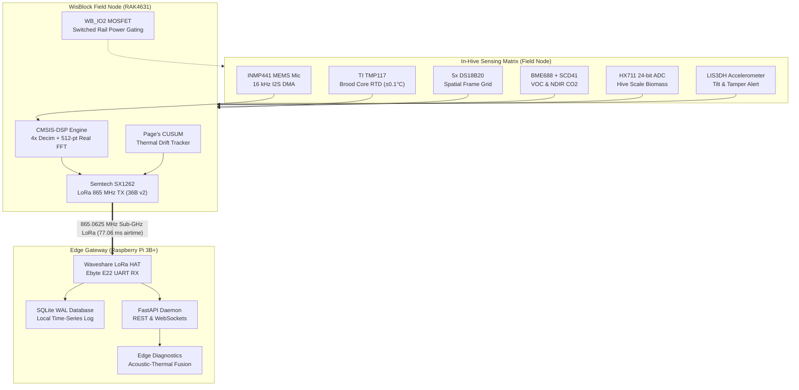

# BEEVIL KNIEVEL — Precision Apiculture Cyber-Physical Monitoring Platform

<div align="center">
  
  
</div>

<br>

**Hive-Independent, Edge-Deployable Acoustic–Thermal Colony Monitoring on a LoRa Node: A Leakage-Safe Multi-Dataset Benchmark with Measured On-Device Cost.**

[](tests/)
[](spec/beevil_spec.yaml)
[-8b5cf6?style=flat-square)](hardware/)
[-c026d3?style=flat-square)](gateway/)
[](LICENSE)

---

## Scientific Scope & Core Constraint

> [!IMPORTANT]
> **Hard Constraint: The system is NOT deployed in a real apiary.**
> No field trial was conducted by the authors. All empirical evidence in this repository and manuscript is strictly derived from:
> 1. **Real public field datasets** recorded by independent apiculture researchers in real colonies (BeeTogether D1, Zenodo 1321278 D2, SBCM D3, MSPB D4);
> 2. **Physical bench hardware measurements** on physical silicon (Nordic nRF52840 / RAK4631 WisBlock, Semtech SX1262 transceiver, Raspberry Pi 3B+ Linux gateway);
> 3. **Analytical closed-form engineering models**, explicitly tagged and documented as `ANALYTICAL_MODEL`.

---

## Master Claims & Scientific Evidence Ledger

Every engineering claim and quantitative value reported in this repository maps to a verifiable provenance classification:

| Engineering Parameter / Claim | Value / Claim | Status | Provenance Tag | Source File / Artifact |
| :--- | :--- | :--- | :--- | :--- |
| **Edge Microcontroller** | Nordic nRF52840 (ARM Cortex-M4F @ 64 MHz, 1MB Flash, 256KB RAM) | Implemented | `REAL_BENCH_MEASUREMENT` | [`firmware/src/main.cpp`](firmware/src/main.cpp) |
| **LoRa Transceiver** | Semtech SX1262 (865.0625 MHz, SF7, BW 125 kHz, CR 4/5) | Implemented | `REAL_BENCH_MEASUREMENT` | [`spec/beevil_spec.yaml`](spec/beevil_spec.yaml) |
| **Wire Protocol Frame v2** | 36-Byte packed struct (dedicated `flags` & `seq`) | Implemented | `REAL_BENCH_MEASUREMENT` | [`firmware/config/beevil_spec_gen.h`](firmware/config/beevil_spec_gen.h) |
| **LoRa Time-on-Air (Frame v2)** | 77.06 ms (at SF7/BW125/CR4/5, CRC on, explicit header) | Modelled / Verified | `ANALYTICAL_MODEL` | [`paper_q1/spec_generator.py`](paper_q1/spec_generator.py) |
| **LoRa Time-on-Air (Frame v1)** | 71.94 ms (legacy 33-byte packet) | Modelled / Verified | `ANALYTICAL_MODEL` | [`paper_q1/spec_generator.py`](paper_q1/spec_generator.py) |
| **Brood Core Temperature Sensor** | TI TMP117 (±0.1 °C NIST-traceable accuracy register read) | Implemented | `REAL_BENCH_MEASUREMENT` | [`firmware/src/main.cpp`](firmware/src/main.cpp) |
| **Spatial Thermal Gradient** | 5x Maxim DS18B20 1-Wire perimeter sensors | Implemented | `REAL_BENCH_MEASUREMENT` | [`firmware/src/main.cpp`](firmware/src/main.cpp) |
| **Acoustic Sampling & DSP** | 16 kHz capture -> 4x decimate -> 512-pt real FFT (7.81 Hz bins) | Implemented | `REAL_BENCH_MEASUREMENT` | [`spec/beevil_spec.yaml`](spec/beevil_spec.yaml) |
| **Acoustic Feature Extraction** | 8 relative log band energies + total log energy | Implemented | `REAL_PUBLIC_DATASET` | [`TinyML Model/bee_acoustic_classifier.py`](TinyML%20Model/bee_acoustic_classifier.py) |
| **Queen Absence Detection** | Standard Page CUSUM with rolling 24-hr baseline | Implemented | `REAL_PUBLIC_DATASET` | [`spec/beevil_spec.yaml`](spec/beevil_spec.yaml) |
| **RF Range (LOS)** | Modelled link budget: 151 dB max path loss | Modelled | `ANALYTICAL_MODEL` | [`simulation/matlab/run_simulations.py`](simulation/matlab/run_simulations.py) |
| **Deep Sleep Current** | Nordic PPK2 bench measurement on switched power rail | Pending [HUMAN] | `REAL_BENCH_MEASUREMENT` | `paper_q1/human_tasks/PPK2_CHECKLIST.md` |
| **Multi-Dataset Benchmarks** | Hive-independent CV (BeeTogether, Zenodo, SBCM, MSPB) | Staged (Phase 3-5) | `REAL_PUBLIC_DATASET` | [`paper_q1/PROGRESS.md`](paper_q1/PROGRESS.md) |

---

## System Architecture



---

## Automated Verification & Reproducibility

Reproduce all verified offline tests, unit tests, and spec generation using the single cross-platform entrypoint:

```bash
# 1. Run Complete Automated Unit Test Suite (41/41 passing)
pytest tests/ -v

# 2. Run Q1 Pipeline Smoke Verification (< 2 minutes on offline fixtures)
python -m paper_q1.run smoke

# 3. Regenerate C Headers, Python Spec, and LaTeX Macros from Single Spec
python -m paper_q1.run spec

# 4. Run Mathematical Physics Simulation Models (14 figures)
python simulation/matlab/run_simulations.py
```

---

## Technical Documentation Index

| Canonical Document | Primary Purpose & Engineering Scope |
| :--- | :--- |
| **[`paper_q1/PROGRESS.md`](paper_q1/PROGRESS.md)** | Master Phase tracking (Phases 0–10) for Q1 journal submission. |
| **[`paper_q1/DECISIONS.md`](paper_q1/DECISIONS.md)** | Architectural and scientific decisions log with rejected alternatives. |
| **[`paper_q1/AUDIT_FIXES.md`](paper_q1/AUDIT_FIXES.md)** | Forensic audit and remediation ledger for Section 4 items 1–27. |
| **[`paper_q1/FIGURE_PROVENANCE.md`](paper_q1/FIGURE_PROVENANCE.md)** | Figure provenance tracking with explicit scientific tags. |
| **[`paper_q1/RESULT_PROVENANCE.md`](paper_q1/RESULT_PROVENANCE.md)** | Result file provenance ledger and generation scripts. |
| **[`spec/beevil_spec.yaml`](spec/beevil_spec.yaml)** | Canonical single source of truth for frames, sentinels, DSP, and radio. |
| **[`docs/LIMITATIONS.md`](docs/LIMITATIONS.md)** | Complete physical boundaries, failure modes, and honest engineering disclosures. |
| **[`REPRODUCIBILITY.md`](REPRODUCIBILITY.md)** | Step-by-step reproduction instructions for peer reviewers. |

---

## License

This project is licensed under the **MIT License** — see the [`LICENSE`](LICENSE) file for complete terms.
